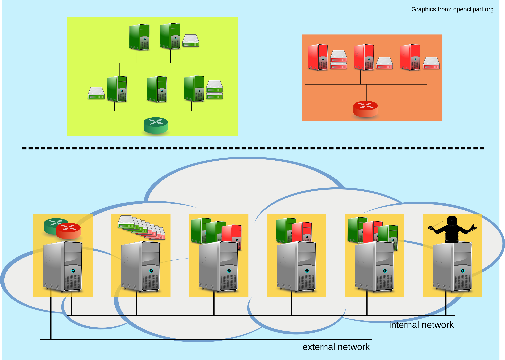
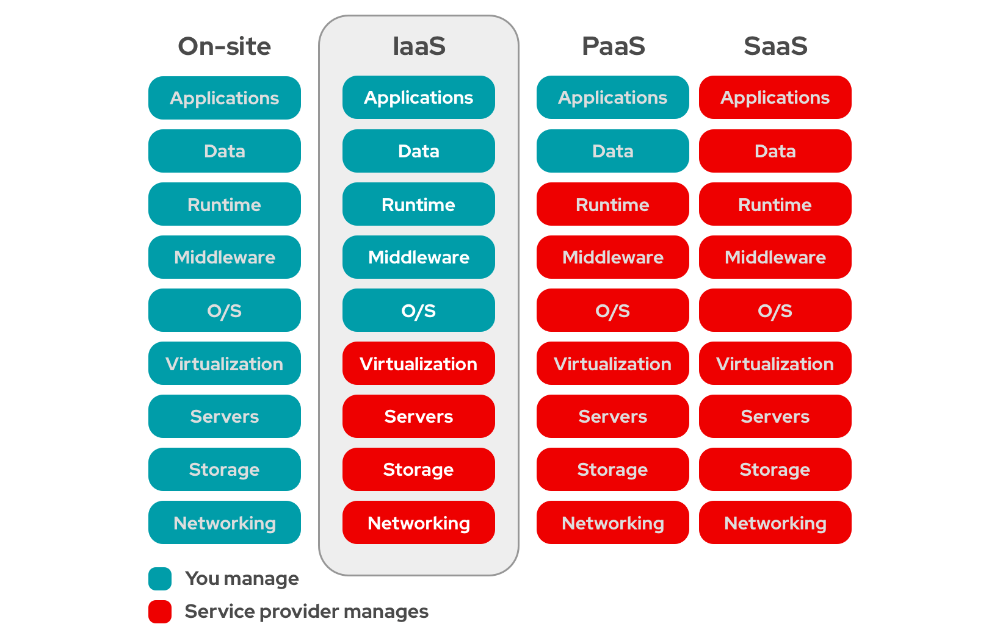
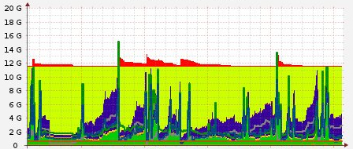
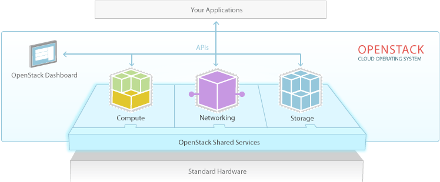

<!-- _class: portada -->
<!-- _paginate: false -->
<!-- _header: '' -->

# Introducción al **Cloud Computing**

## Infraestructura, modelos de servicio y OpenStack

<div style="margin-top:2rem; display:flex; flex-direction:column; gap:0.5rem; justify-content:center; font-size:0.85rem; color:white">
  <span>📧 José Domingo Muñoz</span>
  <span>🏫 IES Gonzalo Nazareno · Dos Hermanas</span>
  <span>📚 IV · Infraestructura Virtual</span>
</div>

---

<!-- _class: capitulo -->
<!-- _paginate: false -->

<p class="numero">01</p>

# La nube hoy

## Qué es, cómo se usa y quién la ofrece

---

## Ya usas la nube

Casi todo lo que haces en Internet se ejecuta en la infraestructura de **otro**:

<div class="cols-3" style="margin-top:0.8rem">

<div class="card card-blue">

### Como usuario

- Correo web, Google Drive, Nextcloud
- Netflix, Spotify, YouTube
- Las copias de seguridad del móvil

</div>

<div class="card card-green">

### Como desarrollador

- GitHub, GitLab
- Despliegue de una web sin tocar un servidor
- Bases de datos gestionadas

</div>

<div class="card card-purple">

### Como administrador

- Máquinas, redes y discos **creados en segundos**
- Sin comprar ni montar hardware
- Es lo que vamos a hacer en esta unidad

</div>

</div>

<div class="alerta alerta-info" style="margin-top:0.6rem">
<span>ℹ️</span><div>«La nube» no es un lugar: son <strong>centros de datos</strong> con miles de servidores, cuyos recursos se ofrecen <strong>como servicio</strong> a través de la red.</div>
</div>

---

## ¿Qué es el Cloud Computing?

> Un modelo para acceder **bajo demanda y por red** a un conjunto **compartido** de recursos (cómputo, almacenamiento, redes…) que se pueden **crear y liberar rápidamente**, casi sin intervención del proveedor. *(Definición del NIST)*

| Característica | Qué significa |
|:--|:--|
| **Autoservicio bajo demanda** | Pides los recursos tú mismo, sin hablar con nadie |
| **Acceso por red** | Todo se gestiona y se usa a través de la red |
| **Recursos compartidos** | El mismo hardware sirve a muchos clientes, **aislados** entre sí |
| **Elasticidad** | Los recursos crecen y decrecen según la necesidad |
| **Servicio medido** | Se mide lo que usas, y se **paga por uso** |

---

## Pedir un servidor: antes y ahora

<div class="cols-2" style="margin-top:0.6rem">

<div class="card card-red">

### Antes

1. Pedir presupuesto y comprar el servidor
2. Esperar a que llegue, montarlo y cablearlo
3. Instalar y configurar el sistema
4. **Semanas** después… ya se puede usar

</div>

<div class="card card-green">

### Ahora

1. Una orden o una **llamada a una API**
2. **Segundos** después… ya se puede usar
3. Cuando no hace falta, **se borra** y se deja de pagar

</div>

</div>

```
$ openstack server create --image "Debian 13" --flavor m1.small \
      --network mi_red --key-name mi_clave servidor1
```

- En la nube **todo es una API**: el panel web, la línea de comandos y los programas hacen las mismas llamadas
- Por eso la infraestructura se puede **automatizar** y describir en ficheros: **infraestructura como código**

---

## ¿Quién ofrece la nube?

<div class="cols-3" style="margin-top:0.8rem">

<div class="card card-blue">

### Los grandes proveedores

- **AWS**, **Microsoft Azure**, **Google Cloud**
- Centros de datos por todo el mundo, organizados en **regiones**
- Cientos de servicios distintos

</div>

<div class="card card-green">

### Proveedores europeos

- **OVHcloud**, **Scaleway**, **IONOS**, **Hetzner**…
- Datos en Europa y bajo legislación europea: **soberanía del dato**
- Algunos usan **OpenStack** (por ejemplo, OVHcloud)

</div>

<div class="card card-purple">

### Tu propia nube

- La organización monta su cloud en **sus servidores**
- Mismo modelo: autoservicio, API, elasticidad
- Es nuestro caso: **OpenStack** en el instituto

</div>

</div>

<div class="alerta alerta-warning" style="margin-top:0.6rem">
<span>⚠️</span><div>Usar la nube de otro es <strong>delegar</strong>: comodidad a cambio de depender del proveedor. Lo veremos al comparar cloud público y privado.</div>
</div>

---

<!-- _class: capitulo -->
<!-- _paginate: false -->

<p class="numero">02</p>

# Evolución de la infraestructura

## Tradicional, virtualización e infraestructura en nube

---

## ¿A qué llamamos infraestructura?

> **Equipos para procesamiento, conexión y almacenamiento de datos.**

<div class="cols-3" style="margin-top:0.8rem">

<div class="card card-blue">

### Infraestructura tradicional

- Adquisición y montaje físico de equipos
- Conexión mediante redes físicas
- **Estática**: mismas configuraciones durante años
- Usuarios sin acceso directo

</div>

<div class="card card-green">

### Virtualización de máquinas

- Varios MVs en un solo equipo físico
- El software de gestión se llama **hipervisor**
- MVs conectadas en redes virtuales
- Ejemplos: KVM, Xen, Proxmox, VMware…

</div>

<div class="card card-purple">

### Infraestructura en nube

- Virtualización de máquinas, **red** y **almacenamiento**
- Agrupamiento de recursos en clúster
- **Dinámica** y configuración automática
- El usuario **sí puede gestionar** su propia infraestructura

</div>

</div>

---

## Esquema de infraestructura IaaS



---

<!-- _class: capitulo -->
<!-- _paginate: false -->

<p class="numero">03</p>

# Cloud Computing

## Características, modelos de servicio y tipos de despliegue

---

## Características del Cloud Computing

<div class="cols-2" style="margin-top:0.8rem">

<div class="card card-blue">

### Modelo de consumo

- Servicio disponible **a demanda** y de forma automática
- Los servicios son **elásticos**: se crean o destruyen recursos según sea necesario
- Se **paga por uso**

</div>

<div class="card card-green">

### Modelo técnico

- Los servicios se comparten con otros usuarios garantizando **aislamiento y seguridad**
- Se ejecutan en un **clúster de ordenadores** ("la nube")
- Los servicios ofrecidos se denominan **… as a Service (…aaS)**

</div>

</div>

---

## Los tres niveles …aaS

> Modelo de negocio: **oferta de servicios** cloud, no venta de licencias o hardware.

<div class="cols-3" style="margin-top:0.8rem">

<div class="card card-blue">

### SaaS — *Software as a Service*

- Aplicación como servicio en la nube
- El usuario accede a través de la web
- Para **usuarios finales**
- Ejemplos: Google Workspace, Office 365

</div>

<div class="card card-green">

### PaaS — *Platform as a Service*

- Plataforma de desarrollo y despliegue en la nube
- Para **desarrolladores de software**
- Ejemplos: Heroku, OpenShift, CloudFoundry

</div>

<div class="card card-purple">

### IaaS — *Infrastructure as a Service*

- Cómputo, redes y almacenamiento como servicio
- Para **administradores de sistemas**
- Ejemplos: AWS, Azure, GCE, OpenStack

</div>

</div>

---

## Comparativa On-site, IaaS, PaaS, SaaS



---

## Tipos de despliegue

<div class="cols-3" style="margin-top:0.8rem">

<div class="card card-blue">

### Público

Una empresa ofrece servicios a terceros, encargándose de **toda la gestión** del cloud.

**Ejemplos:** AWS, Azure, Google Cloud

</div>

<div class="card card-green">

### Privado

Una organización configura sus propios recursos de forma flexible. También llamado ***On-premise cloud***.

**Ejemplos:** OpenStack, VMware

</div>

<div class="card card-yellow">

### Híbrido

Se combinan recursos de nube **privada y pública** según las necesidades. Suelen compartir una API común para facilitar la integración.

</div>

</div>

---

## Cloud privado vs Cloud público

Los clouds públicos tienen aspectos negativos a tener en cuenta:

<div class="cols-2" style="margin-top:0.8rem">

<div class="card card-red">

### Inconvenientes del cloud público

- **Privacidad** y **seguridad** de los datos
- **Vendor lock-in** — dependencia del proveedor
- Escaso **control sobre los datos**
- Limitada **personalización**
- Posibles problemas de **rendimiento**
- **Costes** difíciles de predecir

</div>

<div class="card card-green">

### ¿Cuándo considerar el cloud privado?

Un cloud **privado o híbrido** es una opción muy a tener en cuenta cuando alguno de los aspectos anteriores es importante para la organización.

**Opción principal:** OpenStack sobre hardware convencional.

</div>

</div>

---

## IaaS — caso de uso: demanda variable

<div class="cols-60-40" style="margin-top:0.8rem">

<div>

**IaaS es especialmente adecuado para servicios con demanda variable, como el web.**

### Ejemplo: servicio de vídeo bajo demanda

- **Problema:** requisitos de hardware muy variables, con grandes picos y valles
- **Alto coste** en infraestructura tradicional
- **Solución con IaaS:**
  - Balanceadores para repartir la carga
  - Nuevos servidores creados automáticamente cuando se precisan
  - Servidores eliminados cuando baja la demanda

</div>

<div style="display:flex; align-items:center">



</div>

</div>

---

<!-- _class: capitulo -->
<!-- _paginate: false -->

<p class="numero">04</p>

# OpenStack

## Software libre para nubes públicas y privadas

---

## ¿Qué es OpenStack?

> **OpenStack** es software libre para crear y gestionar nubes públicas y privadas (IaaS).



---

## ¿Por qué OpenStack?

<div class="cols-2" style="margin-top:0.8rem">

<div class="card card-blue">

### Razones técnicas

- Permite montar un **IaaS propio** sobre hardware convencional
- Diseño **modular** con APIs web estándar
- Cada vez **más fácil de instalar**
- **Funcionalidades muy completas**

</div>

<div class="card card-green">

### Razones estratégicas

- **Software libre** (licencia Apache 2.0)
- Sin versión *enterprise* — sin vendor lock-in
- Proyecto **estable** con enorme respaldo industrial
- Proceso de diseño **abierto y transparente**
- Orientado a **estándares abiertos**

</div>

</div>

---

## Historia de OpenStack

- El proyecto nace hacia **2010** de dos iniciativas:
  - **Rackspace** — software de almacenamiento de objetos
  - **NASA** — software para IaaS
- En **septiembre de 2012** el control pasa a la **OpenStack Foundation**, hoy renombrada como **OpenInfra Foundation**
- Acoge a todos los desarrolladores y empresas que trabajan en OpenStack

### Versiones

- Hasta la versión **W**: nombres de ciudades donde se celebraba el *Summit* anual
- A partir de **Wallaby**: nombre propuesto por la comunidad
- A partir de **2023**: formato `año.N + palabra con A` — dos versiones por año

---

## Componentes principales de OpenStack

| Componente | Función |
|:--|:--|
| **Nova** | Gestión de las máquinas virtuales (Computación) |
| **Keystone** | Autenticación y autorización |
| **Glance** | Gestión de imágenes de MV |
| **Neutron** | Gestión de redes virtuales |
| **Cinder** | Almacenamiento en bloque (discos persistentes) |
| **Horizon** | Panel web de administración (*Dashboard*) |
| **Heat** | Orquestación de escenarios (infraestructura como código) |

<div class="alerta alerta-info" style="margin-top:0.5rem">
<span>ℹ️</span><div>OpenStack tiene muchos más componentes opcionales. Listado completo en <strong>openstack.org/software/project-navigator</strong>.</div>
</div>

---

<!-- _class: cierre -->
<!-- _paginate: false -->

# ¡Gracias!

## Introducción al Cloud Computing

<div style="margin-top:2rem; display:flex; gap:2rem; justify-content:center; font-size:0.85rem; color:#64748b">
  <span>📧 José Domingo Muñoz</span>
  <span>🏫 IES Gonzalo Nazareno · Dos Hermanas</span>
  <span>📚 IV</span>
</div>
