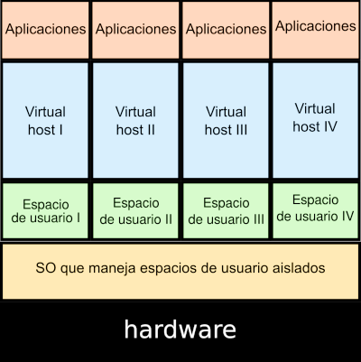

<!-- _class: portada -->
<!-- _paginate: false -->
<!-- _header: '' -->

# Virtualización en **contenedores**

## Concepto y tipos de contenedores

  📧 José Domingo Muñoz
  🏫 IES Gonzalo Nazareno · Dos Hermanas
  📚 IV · Infraestructura Virtual

---

<!-- _class: capitulo -->
<!-- _paginate: false -->

01

# Virtualización ligera en contenedores

## Concepto y tipos

---

## ¿Qué es la virtualización en contenedores?

- También llamada **virtualización a nivel de sistema operativo** o **virtualización basada en contenedores**
- Sobre el núcleo del SO se ejecuta una capa de virtualización que permite múltiples **instancias aisladas** de espacios de usuario
- Un **contenedor** es un conjunto de procesos aislados con:
  - **Sistema de ficheros** propio
  - **Configuración de red** propia
  - Acceso a los recursos del host (memoria y CPU)

---

## Tipos de contenedores

### Contenedores de sistema

Su uso es similar al de una **máquina virtual tradicional**:

- Se accede por **SSH**
- Se instalan servicios, se actualizan
- Ejecutan un conjunto de procesos en paralelo

**Ejemplo:** `LXC` *(Linux Container)*

### Contenedores de aplicación

Pensados para el **despliegue de aplicaciones** web:

- Una aplicación por contenedor
- Paradigma *build, ship and run*
- El contenedor se para cuando termina su proceso principal

**Ejemplos:** `Docker`, `Podman`

---

<!-- _class: cierre -->
<!-- _paginate: false -->

# ¡Gracias!

## Virtualización en contenedores

  📧 José Domingo Muñoz
  🏫 IES Gonzalo Nazareno · Dos Hermanas
  📚 IV

