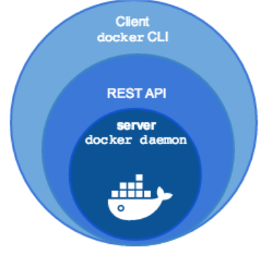

<!-- _class: portada -->
<!-- _paginate: false -->
<!-- _header: '' -->

# **Docker**

## Contenedores de aplicación

<div style="margin-top:2rem; display:flex; flex-direction:column; gap:0.5rem; justify-content:center; font-size:0.85rem; color:white">
  <span>📧 José Domingo Muñoz</span>
  <span>🏫 IES Gonzalo Nazareno · Dos Hermanas</span>
  <span>📚 IV · Infraestructura Virtual</span>
</div>

---

<!-- _class: capitulo -->
<!-- _paginate: false -->

<p class="numero">01</p>

# Introducción a Docker

## Concepto, componentes y ecosistema

---

## ¿Qué es Docker?

> **Docker** es una tecnología de virtualización ligera cuyo objetivo es el **despliegue de aplicaciones** encapsuladas en contenedores bajo la filosofía **build, ship and run**.

### Características principales

- *"docker"* = **estibador** (quien carga y descarga contenedores)
- Pertenece a los **contenedores de aplicación**
- El contenedor **ejecuta un comando** y se detiene cuando este termina
- Cambia completamente la forma de **desplegar y distribuir** aplicaciones
- Escrito en **Go** — software libre (no todos los componentes)
- Desarrollado por **Docker, Inc.**

---

## Componentes del software Docker

<div class="cols-60-40" style="margin-top:0.8rem">

<div>

### Docker Engine
- **Demonio Docker** — gestiona contenedores e imágenes
- **Docker API** — interfaz REST para automatización
- **Docker CLI** — cliente de línea de comandos

### Docker Registry
- Distribuye las **imágenes Docker**
- **Registro público**: Docker Hub (`hub.docker.com`)
- **Registro privado**: instalado en un servidor local

**Herramientas adicionales:** `docker compose` (aplicaciones multicontenedor) y `docker swarm` (orquestador)

</div>

<div style="display:flex; align-items:center">



</div>

</div>

---

## Docker en la actualidad — CNCF

- En **2015** se crea la **Cloud Native Computing Foundation (CNCF)** como proyecto de la Linux Foundation para impulsar la tecnología de contenedores
- Todas las grandes empresas tecnológicas forman parte de la CNCF
- También en **2015** se crea la **Open Container Initiative (OCI)**, que define los estándares abiertos de las imágenes y de la ejecución de contenedores. Docker Inc. es miembro fundador de las dos
- Los componentes fundamentales de Docker son proyectos libres independientes:
  - **`runC`** — motor de ejecución de contenedores (donado a la OCI)
  - **`containerd`** — gestión del ciclo de vida de contenedores (proyecto de la CNCF)
- Las **imágenes Docker** y su distribución se convierten en estándar abierto (**OCI**)

---

## Distribuciones de Docker

| Variante | Descripción |
|:--|:--|
| **Moby** | Proyecto de comunidad. Paquete `docker.io` en Debian |
| **Docker CE** | *Community Edition* — proporcionado por Docker Inc. |

### Alternativas a Docker bajo los estándares OCI

- **`cri-o`** — creado por Red Hat, pensado para integrarse en Kubernetes
- **`podman`** — creado por Red Hat, alternativa sin demonio a Docker
- **`containerd` + `nerdctl`** — el motor de Docker usado directamente, con una CLI compatible

---

## Contenedores y tipos de aplicación

<div class="cols-2" style="margin-top:0.8rem">

<div class="card card-blue">

### Aplicaciones monolíticas

Se usa un esquema **multicapa**:

- Cada servicio en un contenedor separado
- Servicio web + base de datos + caché…

</div>

<div class="card card-green">

### Aplicaciones con microservicios

El modelo que mejor se adapta a Docker:

- Cada **microservicio** en su propio contenedor
- Comunicación vía **HTTP REST** y colas de mensajes
- Facilita las **actualizaciones** de cada componente de forma independiente

</div>

</div>

---

<!-- _class: capitulo -->
<!-- _paginate: false -->

<p class="numero">02</p>

# Primeros pasos con Docker

## Instalación y ejecución de contenedores

---

## Instalación de Docker

Trabajamos con **Moby**, la distribución Docker de la comunidad. En Debian:

```bash
$ apt install docker.io docker-compose
$ docker --version
Docker version 26.1.5+dfsg1, build a72d7cd
```

En Debian 13 (trixie), el paquete `docker-compose` es **Compose v2** (2.26): se instala como plugin de Docker y se usa con **`docker compose`**.

Para usar Docker con un usuario sin privilegios, añadirlo al grupo `docker` y reiniciar la sesión:

```bash
$ sudo usermod -aG docker $USER
```

---

## El "Hola Mundo" de Docker

```bash
$ docker run hello-world
Unable to find image 'hello-world:latest' locally
Hello from Docker!   (salida recortada)
```

¿Qué ha ocurrido?

1. El cliente Docker conecta con el **servidor Docker** (demonio)
2. La imagen no estaba entre las **imágenes locales** → se descarga de **Docker Hub** (solo la primera vez)
3. Se crea el contenedor, que ejecuta un proceso. **Cuando el proceso termina, el contenedor se para**

```bash
$ docker ps -a
CONTAINER ID   IMAGE         COMMAND    CREATED        STATUS                   NAMES
f88fe68a16fc   hello-world   "/hello"   1 min ago      Exited (0) 1 min ago     interesting_greider
```

---

## Ejecución simple de contenedores

Con `docker run` creamos un contenedor indicando la imagen. Si no indicamos comando, **se ejecuta el definido por defecto en la imagen**:

```bash
$ docker run ubuntu echo 'Hello world'
Hello world
```

El contenedor ejecuta el comando y se para. Para ver las imágenes descargadas localmente:

```bash
$ docker images
```

---

## Contenedores interactivos

Opciones `-i` (sesión interactiva) y `-t` (pseudo-terminal). Con `--name` asignamos nombre:

```bash
$ docker run -it --name contenedor1 ubuntu bash
root@2bfa404bace0:/#
```

El contenedor se para al salir. Para volver a acceder y, si está en ejecución, lanzar comandos con `exec`:

```bash
$ docker start contenedor1        # arrancarlo de nuevo
$ docker attach contenedor1       # conectarse a su terminal
$ docker exec contenedor1 ls -al  # ejecutar un comando (en ejecución)
$ docker restart contenedor1      # reiniciar
$ docker inspect contenedor1      # información detallada
```

---

<!-- _class: capitulo -->
<!-- _paginate: false -->

<p class="numero">03</p>

# Contenedores demonio

## Modo detach, mapeo de puertos y variables de entorno

---

## Contenedores en segundo plano (`-d`)

La opción `-d` (*detach*) ejecuta el contenedor en segundo plano. Con `-p` mapeamos un puerto del host a un puerto del contenedor:

```bash
$ docker run -d --name my-apache-app -p 8080:80 httpd:2.4
```

- `8080:80` → el puerto `8080` del host redirige al puerto `80` del contenedor
- Accedemos con la **IP del host** y el puerto mapeado: la IP del contenedor solo es accesible desde el host y cambia al recrearlo

```bash
$ docker logs my-apache-app       # ver logs
$ docker logs -f my-apache-app    # logs en tiempo real
$ docker stop my-apache-app
$ docker rm my-apache-app
$ docker rm -f my-apache-app      # parar y borrar en un paso
```

---

## Modificar el contenido de un contenedor

Tres formas de crear o modificar ficheros dentro del contenedor:

```bash
# 1. Accediendo de forma interactiva
$ docker exec -it my-apache-app bash
root@...:/# echo "<h1>Curso Docker</h1>" > /usr/local/apache2/htdocs/index.html

# 2. Ejecutando el comando directamente
$ docker exec my-apache-app bash -c \
    'echo "<h1>Curso Docker</h1>" > /usr/local/apache2/htdocs/index.html'

# 3. Copiando un fichero desde el host
$ echo "<h1>Curso Docker</h1>" > index.html
$ docker cp index.html my-apache-app:/usr/local/apache2/htdocs/
```

---

## Variables de entorno (`-e`)

Muchas imágenes se configuran a través de **variables de entorno**. Se definen con `-e` o `--env` al crear el contenedor:

<div class="cols-2">

<div>

```bash
$ docker run -it --name contenedor5 \
    -e USUARIO=prueba ubuntu bash
root@91e81200c633:/# echo $USUARIO
prueba
```

</div>

<div>

La imagen `mariadb` **requiere** `MARIADB_ROOT_PASSWORD`:

```bash
$ docker run -d --name some-mariadb \
    -e MARIADB_ROOT_PASSWORD=my-secret-pw mariadb
$ docker exec -it some-mariadb mariadb -u root -p
```

</div>

</div>

<div class="alerta alerta-info" style="margin-top:0.5rem">
<span>ℹ️</span><div>La documentación de cada imagen en <strong>Docker Hub</strong> indica qué variables de entorno acepta y cuáles son obligatorias.</div>
</div>

---

<!-- _class: capitulo -->
<!-- _paginate: false -->

<p class="numero">04</p>

# Imágenes Docker

## Concepto, gestión y sistema de capas

---

## ¿Qué es una imagen Docker?

- Una **imagen Docker** es una plantilla de **solo lectura** con un sistema de ficheros. A partir de ella se crean los contenedores
- Si modificamos un contenedor, los cambios **no se reflejan en la imagen**
- El nombre de una imagen sigue el formato `usuario/nombre:etiqueta`:
  - `usuario` — quien la generó. Las **imágenes oficiales** en Docker Hub no tienen usuario
  - `nombre` — nombre significativo de la imagen
  - `etiqueta` — versión. Si se omite se usa `latest` por defecto

### Tipos de imágenes en Docker Hub

<div class="cols-2">

<div>

- **Sistemas operativos**: Ubuntu, Debian, Fedora…
- **Lenguajes**: PHP, Java, Python…

</div>

<div>

- **Servicios**: Apache, MySQL, Nginx, Tomcat…
- **Aplicaciones**: WordPress, Nextcloud, MediaWiki…

</div>

</div>

---

## Gestión de imágenes

```bash
docker images               # imágenes locales
docker pull <imagen>        # descargar imagen sin crear contenedor
docker rmi <imagen>         # eliminar imagen (no si hay contenedores creados)
docker search <término>     # buscar imágenes en Docker Hub
docker inspect <imagen>     # información detallada
```

<div class="alerta alerta-warning" style="margin-top:0.6rem">
<span>⚠️</span><div>No se puede eliminar una imagen si existe algún contenedor creado a partir de ella, aunque esté parado.</div>
</div>

---

## Sistema de capas

Una imagen está formada por **capas de solo lectura** apiladas con un *union filesystem*:

```
┌──────────────────────────┐
│ Capa 3: index.html       │
├──────────────────────────┤
│ Capa 2: nginx instalado  │
├──────────────────────────┤
│ Capa 1: Ubuntu base      │
└──────────────────────────┘
```

- Cada capa representa un cambio: instalar un paquete, copiar un fichero, modificar configuración
- Las capas se **comparten entre imágenes**: si varias usan la misma base, esa capa solo se guarda una vez

---

## Capa de escritura del contenedor

Al crear un contenedor, Docker monta las capas de la imagen (RO) y añade **una capa de escritura** exclusiva del contenedor:

```
┌─────────────────────────────────┐ ← Capa RW: cambios del contenedor
│ Logs, configs, archivos nuevos  │
├─────────────────────────────────┤
│ Capas de la imagen (RO)         │ ← Vista completa del sistema
└─────────────────────────────────┘
```

- Un contenedor recién creado ocupa muy poco espacio (p. ej. **5 B**; se ve con `docker ps -s`)
- Solo ocupa lo que escribe en su capa (**aprovisionamiento ligero**)
- **Al borrar el contenedor se pierde su capa** y todos sus datos

<div class="alerta alerta-info" style="margin-top:0.5rem">
<span>ℹ️</span><div>Este mecanismo es similar a la <strong>clonación enlazada</strong> en máquinas virtuales con <em>backing store</em>.</div>
</div>

---

## Ejemplo: múltiples versiones de una imagen

```bash
docker run -d -p 8080:80 --name mediawiki1 mediawiki
docker run -d -p 8081:80 --name mediawiki2 mediawiki:1.43
docker run -d -p 8082:80 --name mediawiki3 mediawiki:1.39
```

- Cada contenedor sirve una **versión distinta** de MediaWiki
- Al descargar la segunda y tercera imagen, **solo se bajan las capas que difieren** de la primera → ahorro de espacio y tiempo

---

<!-- _class: capitulo -->
<!-- _paginate: false -->

<p class="numero">05</p>

# Almacenamiento en Docker

## Volúmenes Docker y bind mounts

---

## Los contenedores son efímeros

> Los datos de un contenedor **sobreviven a las paradas**, pero se pierden al **eliminarlo**.

Docker ofrece dos mecanismos para **persistir datos**:

<div class="cols-2" style="margin-top:0.8rem">

<div class="card card-blue">

### Volúmenes Docker

- Gestionados por Docker en `/var/lib/docker/volumes`
- El usuario no gestiona directamente el directorio
- Portables y fáciles de respaldar

</div>

<div class="card card-green">

### Bind mounts

- El usuario elige el **directorio del host** que se monta
- Control total sobre la ubicación de los datos
- Permite montar tanto **directorios** como **ficheros**

</div>

</div>

---

## Gestión de volúmenes Docker

```bash
docker volume create <nombre>   # crear volumen
docker volume ls                # listar volúmenes
docker volume inspect <nombre>  # información detallada
docker volume rm <nombre>       # eliminar volumen
docker volume prune [-a]        # eliminar volúmenes anónimos sin usar (-a: también los con nombre)
```

Usar un volumen al crear el contenedor con `-v nombre:ruta_contenedor`:

```bash
$ docker volume create miweb
$ docker run -d --name my-apache-app \
    -v miweb:/usr/local/apache2/htdocs \
    -p 8080:80 httpd:2.4
```

Al borrar y recrear el contenedor montando el mismo volumen, **los datos persisten**.

---

## Bind mounts

Montar un directorio del host en el contenedor con `-v ruta_host:ruta_contenedor`. Los cambios en el directorio del host se reflejan **inmediatamente** en el contenedor:

```bash
$ mkdir web && echo "<h1>Hola</h1>" > web/index.html
$ docker run -d --name my-apache-app \
    -v /home/usuario/web:/usr/local/apache2/htdocs -p 8080:80 httpd:2.4

$ echo "<h1>Adios</h1>" > web/index.html     # cambio en el host
$ curl http://localhost:8080
<h1>Adios</h1>
```

<div class="alerta alerta-warning" style="margin-top:0.5rem">
<span>⚠️</span><div>Un <strong>bind mount</strong> oculta lo que había en el directorio del contenedor. Un <strong>volumen vacío</strong> se rellena con ese contenido; si ya tiene datos, se ven los del volumen.</div>
</div>

---

<!-- _class: capitulo -->
<!-- _paginate: false -->

<p class="numero">06</p>

# Redes en Docker

## Redes predefinidas y redes de usuario

---

## Redes predefinidas

Al instalar Docker se crean tres redes:

```bash
$ docker network list
NETWORK ID     NAME      DRIVER    SCOPE
fe965af60795   bridge    bridge    local
eb1b46382ff0   host      host      local
fe713d203f5b   none      null      local
```

<div class="cols-3" style="margin-top:0.8rem">

<div class="card card-blue">

### `bridge` (por defecto)

Red NAT: Docker asigna la IP y el DNS. Se usa `-p` para **exponer puertos**.

</div>

<div class="card card-green">

### `host`

**Comparte la red del host**: sin IP propia ni mapeo de puertos.

</div>

<div class="card card-yellow">

### `none`

Solo loopback: procesos **completamente aislados**.

</div>

</div>

---

## La red bridge por defecto

Los contenedores se conectan por defecto a una **red de tipo NAT** con estas características:

| Parámetro | Valor |
|:--|:--|
| Bridge en el host | `docker0` |
| Direccionamiento | `172.17.0.0/16` |
| IP del host | `172.17.0.1` |
| Asignación de IP | Automática: la asigna **Docker** al crear el contenedor |
| DNS | Los **servidores DNS del host** |
| Salida a Internet | Sí (el host hace NAT) |

<div class="alerta alerta-warning" style="margin-top:0.6rem">
<span>⚠️</span><div>La red <code>bridge</code> por defecto <strong>no ofrece resolución DNS</strong> entre contenedores por nombre. Para eso hay que usar redes definidas por el usuario.</div>
</div>

---

## Redes definidas por el usuario

En producción **no se usa la red bridge por defecto**. Se crean redes propias por dos razones:

1. Proporcionan **resolución DNS** entre contenedores por nombre
2. Mayor **aislamiento**: los contenedores de una aplicación no comparten red con otros

```bash
docker network create red1
docker network create -d bridge --subnet 172.24.0.0/16 --gateway 172.24.0.1 red2

docker network ls
docker network inspect red1
docker network rm red1
docker network prune          # borrar redes sin contenedores

# conectar un contenedor a una red
docker run -d --name my-apache-app --network red1 -p 8080:80 httpd:2.4
```

---

## Resolución DNS en redes de usuario

En una red definida por el usuario, los contenedores se resuelven **por nombre**:

```bash
$ docker run -it --name contenedor1 --network red1 debian bash
root@98ab5a0c2f0c:/# apt update && apt install dnsutils -y
root@98ab5a0c2f0c:/# dig my-apache-app

;; ANSWER SECTION:
my-apache-app.  600  IN  A  172.18.0.2

;; SERVER: 127.0.0.11#53(127.0.0.11)
```

<div class="alerta alerta-info" style="margin-top:0.6rem">
<span>ℹ️</span><div>El servidor DNS interno de Docker (<code>127.0.0.11</code>) resuelve los nombres de los contenedores de la misma red. Esto es imprescindible para que los contenedores de una aplicación se comuniquen entre sí.</div>
</div>

---

<!-- _class: capitulo -->
<!-- _paginate: false -->

<p class="numero">07</p>

# Docker Compose

## Escenarios multicontenedor declarativos

---

## ¿Qué es Docker Compose?

Docker Compose permite definir y gestionar escenarios multicontenedor de forma **declarativa**:

<div class="cols-3" style="margin-top:0.8rem">

<div class="card card-blue">

### Despliegue completo

Levanta **todos los contenedores** de la aplicación de una sola vez, debidamente configurados.

</div>

<div class="card card-green">

### Orden de arranque

Garantiza que los contenedores **se inician en el orden correcto** según sus dependencias (`depends_on`).

</div>

<div class="card card-purple">

### Comunicación

Crea automáticamente una **red definida por el usuario** para que los contenedores se comuniquen por DNS.

</div>

</div>

---

## El fichero `docker-compose.yaml`

<div class="cols-60-40">

<div>

```yaml
services:
  app:
    container_name: letschat
    image: sdelements/lets-chat
    restart: always
    environment:
      LCB_DATABASE_URI: mongodb://mongo/letschat
    ports: ["80:8080"]
    depends_on: [db]
  db:
    container_name: mongo
    image: mongo:4
    restart: always
    volumes: ["mongo:/data/db"]
volumes:
  mongo:
```

</div>

<div>

Ejemplo: aplicación de chat **LetsChat** con base de datos **MongoDB**:

- Dos servicios: `app` y `db`
- `app` se conecta a la base de datos por el **nombre** `mongo`
- `app` arranca después de `db`
- Los datos de MongoDB se guardan en el **volumen** `mongo`

</div>

</div>

---

## Parámetros del fichero Compose

| Parámetro | Descripción |
|:--|:--|
| `services` | Cada entrada define un **contenedor** de la aplicación |
| `image` | Imagen Docker a usar |
| `container_name` | Nombre del contenedor |
| `restart: always` | Política de reinicio automático si el contenedor se para |
| `environment` | Variables de entorno del contenedor |
| `ports` | Mapeo de puertos `host:contenedor` |
| `depends_on` | Orden de arranque: el contenedor arranca **después** del indicado (no espera a que el servicio esté listo) |
| `volumes` | Volúmenes montados (bind mount o volumen Docker) |

---

## Comandos `docker compose`

Se ejecutan en el directorio donde está el fichero `docker-compose.yaml`:

```bash
docker compose up -d          # crear y arrancar todos los contenedores (detach)
docker compose ps             # listar contenedores del escenario
docker compose stop           # parar contenedores
docker compose start          # arrancar contenedores parados
docker compose restart        # reiniciar (útil tras cambios de configuración)
docker compose rm -s          # parar y borrar los contenedores
docker compose down           # parar, borrar contenedores y redes
docker compose down -v        # ídem + borrar volúmenes

docker compose logs           # logs de todos los servicios
docker compose logs -f        # logs en tiempo real
docker compose logs servicio1 # logs de un servicio concreto
docker compose exec servicio1 /bin/bash  # consola en un servicio
docker compose top            # procesos en ejecución por servicio
```

---

<!-- _class: cierre -->
<!-- _paginate: false -->

# ¡Gracias!

## Docker — Contenedores de aplicación

<div style="margin-top:2rem; display:flex; gap:2rem; justify-content:center; font-size:0.85rem; color:#64748b">
  <span>📧 José Domingo Muñoz</span>
  <span>🏫 IES Gonzalo Nazareno · Dos Hermanas</span>
  <span>📚 IV</span>
</div>
